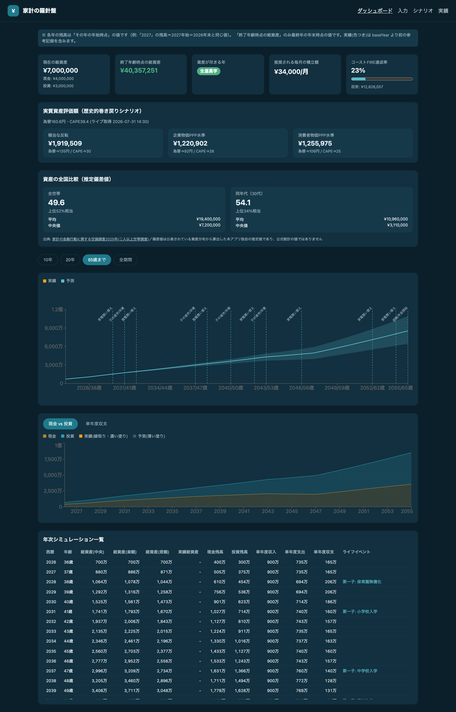
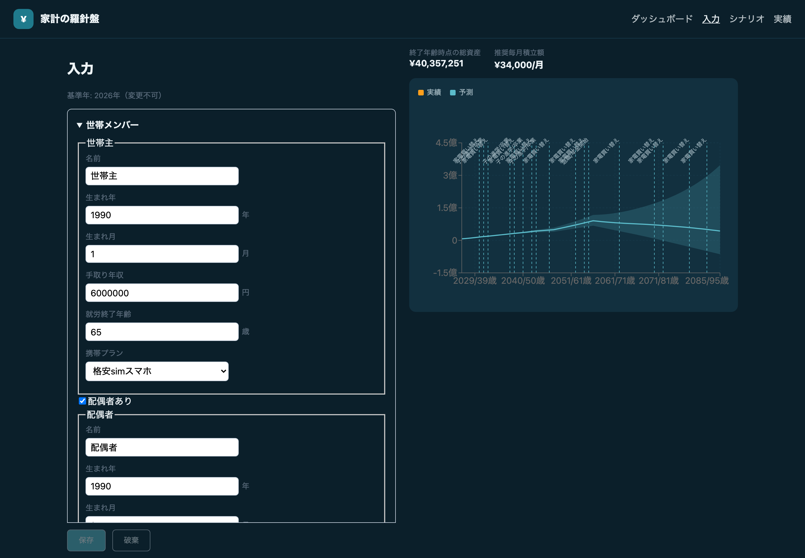

# lifeplan-simulator（家計の羅針盤）

世帯のライフプラン（総資産の推移）を年次でシミュレーションする Web アプリ。

自分の家計を「本番環境しかないシステム」ではなく、**前提を変えて何度でも流せる検証環境**として扱うために作った個人プロジェクトです。車を買っていいか、引っ越していいか、といった判断の材料を出すことを目的にしています。

## デモ

**https://kaaaichi.github.io/lifeplan-simulator/**

匿名のサンプル世帯が入った状態で、そのまま触れます。数字を書き換えるとグラフが即座に変わります。

- **入力したデータはどこにも保存されません。** デモは `memory` モードでビルドしており、Firebase にも認証にも接続しません。値はブラウザのメモリ上にしか無く、**リロードすると初期状態に戻ります**
- 外部通信は2件だけです。為替（`open.er-api.com`）と S&P500 の CAPE レシオ（`posix4e.github.io`）を「実質資産評価額」カードのために取得します。いずれもキー不要の公開データで、**こちらから送るものはありません**（取得に失敗した場合はフォールバック定数で動きます）

## スクリーンショット

以下はすべて、同梱の**匿名のサンプル世帯**（手取り600万＋300万、子1人）で動かした画面です。作者の実データではありません。

### ダッシュボード

総資産の推移（楽観・中央・悲観の3本）、ライフイベントのマーカー、現金 vs 投資、年次テーブル。公的統計と比べた資産の全国比較も出ます。



### 入力

世帯構成・資産・住居・家電の買い替え周期・前提（利回り、保育料、教育費の参照年収帯など）を入力します。入力しながら右側で結果が即座に更新されます。



### シナリオ比較

シナリオを複製して前提を変え、結果を並べて比較します。「車を買ったらどうなるか」を本番に反映せず試すための機能です。


### モバイル


## これは何を計算するのか

- 世帯の収入・支出を**年次で積み上げ**、現金残高・投資残高・総資産の推移を出す
- 利回りを楽観／中央／悲観の3水準で回し、**シナリオを並べて比較**する
- 教育費・保育料・年金・光熱費などは**公的統計や法令を出典とするマスタデータ**から算出する
- 実績値（`Actual`）を入力すると、予測と実測を突き合わせて**モデルを校正**できる

## 設計上の判断

**昇給カーブを持たない。** 手取り年収は定年まで固定です（`src/engine/income.ts`）。収入が右肩上がりに増える前提を置かないという、意図的に保守的なキャパシティ設計です。収入の変動は率ではなく `FinancialEvent`（育休による収入減など）という**離散イベント**として表現します。

**計算エンジンは純粋関数。** `src/engine/` は副作用を持たず、`Inputs` とマスタデータを受け取って値を返すだけです。だから UI を起動せずに CLI（`scripts/simulateCli.ts`）からも叩けますし、テストが書けます。

**マスタデータは外部化。** `src/masterData/` に分離してあるので、一次資料の更新をアプリ本体と独立にできます。

**悲観側に倒す。** 大学費用は一次資料の実額に**一律 +20% のバッファ**を乗せています。一次資料と一致しないのは誤りではなく意図です（`src/masterData/education.ts` の冒頭コメント参照）。

**前提が増えても既存データを壊さない。** 永続化ドキュメントは `schemaVersion` の封筒を持ち、旧版は `migrate.ts` で順に移行、未来版は fail-closed で読み込みを拒否します。

## 技術スタック

React 19 / TypeScript / Vite / Zustand / Recharts / React Router / Firebase（Firestore + セキュリティルール）
テスト: Vitest / Playwright / `@firebase/rules-unit-testing` / Testing Library

## 開発環境について（Claude Code 前提）

**このリポジトリは Claude Code で開発することを前提に構成されています。** アプリ自体の実行に Claude Code は不要ですが、リポジトリには以下が同梱されています。

- `CLAUDE.md` — プロジェクトの設計方針・実装規約・進捗。セッションごとに読み込まれる前提で書かれています
- `.claude/commands/` — スラッシュコマンド。`/lifeplan-simulate` は、条件を対話的にヒアリングして what-if シミュレーションを実行します
- `docs/superpowers/specs/`・`docs/superpowers/plans/` — 設計書と実装プラン。[Superpowers](https://github.com/obra/superpowers) のワークフロー（brainstorming → writing-plans → executing-plans）で作成したものです
- `openspec/` — 仕様駆動開発（OpenSpec）の変更提案とアーカイブ

実装の大部分は Claude Code が書いています。人間側がやったのは、ドメインモデリング（`src/types.ts` の型設計）と、マスタデータの数値を一次資料で裏取りする調査（`research/`）です。

**Codex など他のコーディングエージェントでも操作できると思われますが、未検証です。** `CLAUDE.md` は Claude Code の読み込み規約に沿った書き方をしており、`.claude/commands/` のスラッシュコマンドは Claude Code 固有の形式です。他のエージェントで使う場合は、`CLAUDE.md` を各エージェントの規約（`AGENTS.md` など）に読み替える必要があります。動作報告は歓迎します。

## セットアップ

```bash
cd lifeplan && npm install && npm run dev
```

テスト:

```bash
cd lifeplan && npx vitest run
```

## 自分の世帯データで動かす

既定では匿名のサンプル世帯（`src/persistence/placeholderHousehold.ts`）が読み込まれます。自分の実データを使う場合は `src/persistence/seed.local.json` に `Inputs` 型の JSON を置いてください。このファイルは `.gitignore` 済みで、コミットされません（`src/persistence/seedOverride.ts`）。

世帯固有の値のうち、以下は**マスタデータではなく入力値**です。自分の状況に合わせて設定してください。

- `assumptions.nurseryFeeMonthly` — 0〜2歳児クラスの保育料（月額）。居住自治体が公開している「利用者負担（保育料）徴収基準表」で、世帯の市区町村民税所得割課税額に対応する階層の額を見てください
- `assumptions.educationIncomeBand` — 教育費マスタのどの世帯年収帯を参照するか

## 運用方法

作り終えて終わりではなく、**年に数回、実績を入れて予測とのズレを見て、前提を直す**という運用を前提にしています。その作業を Claude Code にやらせるのが実際の使い方です。

### 実績値を入れる（予測モデルの校正）

画面の「実績」から年ごとの現金残高・投資残高を手入力できますが、**家計簿や口座のエクスポートを Claude Code に渡して集計させるほうが速いです。**

```
家計簿のCSVを渡すので、年末時点の現金残高と投資残高を年ごとに集計して、
実績（Actual）として入力できる形に整えてください。
```

`Actual` は `{ year, cashBalance, investmentBalance, note? }` という単純な型です（`src/types.ts`）。口座が複数あっても、Claude Code に「現金系」「投資系」で寄せさせてから入れれば済みます。

実績を入れると、ダッシュボードのグラフに予測とは別の色で重なって表示され、**モデルがどれだけズレていたかが一目で分かります**。ズレていたら前提（利回り・生活費・年間投資額）を直す、という校正のループが回ります。

### what-if を試す

`/lifeplan-simulate` スラッシュコマンドで、条件を対話的に伝えると what-if シミュレーションが走ります。

```
/lifeplan-simulate
→ 「2028年に車を350万円で買う。ローンは5年、金利2%。維持費は年40万円」
```

内部では既存シナリオを複製し、`FinancialEvent`（車購入・ローン返済・維持費）をマージして再計算します。`--save` を付けない限り Firestore は一切変更されないので、**本番のプランを壊さずに試せます**。

ただしこのコマンドは **Firestore 上の実データに対して動く**設計なので、Firebase 構成（`.env.local` と `scripts/service-account.local.json`）が必要です。`memory` モードで動かしているだけなら、代わりに画面上でシナリオを複製して前提を書き換えてください。

### 機能を追加する

前提が変われば、必要な機能も変わります（実際、保育料も第二子の想定も後から足しています）。追加は Claude Code に投げるのが早いです。

```
住宅ローンの繰り上げ返済をシミュレーションできるようにしたい。
まず設計を詰めてから実装してください。
```

リポジトリには、そのための足場が入っています。

- `CLAUDE.md` — 設計方針・実装規約・これまでの経緯
- `docs/superpowers/specs/`・`plans/` — 設計書と実装プランの置き場
- `openspec/` — 仕様の変更提案とアーカイブ
- `src/engine/` が純粋関数なので、**計算ロジックの変更はテストで守られます**。前提を1つ足すたびに `schemaVersion` を上げて `migrate.ts` に移行関数を書く、という手順も `CLAUDE.md` に書いてあります

数値のマスタデータを足すときだけは注意してください。**出典と、なぜその値にしたのかをコードのコメントに書き残さないと、後から自分でも読めなくなります**（`src/masterData/education.ts` の大学費用は「一次資料 +20% バッファ」という意図的な設定ですが、それが書かれていなかったため、後の調査で誤りと判定されました）。

## 出典

マスタデータは一次資料に基づいています。主なもの:

- 文部科学省「子供の学習費調査」
- 「国立大学等の授業料その他の費用に関する省令」（e-Gov）
- 文部科学省「私立大学入学者に係る初年度学生納付金等調査」
- 日本政策金融公庫「教育費負担の実態調査結果」
- 全国大学生活協同組合連合会「学生生活実態調査」
- 金融広報中央委員会（J-FLEC）「家計の金融行動に関する世論調査2025年」

一次資料との突き合わせの記録は `research/` にあります。各主張には出典（媒体・年・URL）を明記し、一次資料で確認できなかったものは「未確認」と書いています。

## 公開版で省いているもの

このリポジトリは、作者の世帯データを含む非公開リポジトリから、**世帯固有の情報を取り除いて作り直したもの**です（履歴は引き継いでいません）。以下は含まれていません。

- 作者世帯の実データ（氏名・生年月・手取り年収・各残高・家賃）
- そこから算出した golden fixture（エンジン出力の期待値）
- 世帯固有の分析が本体を占める調査レポート2本（育児休業給付金の手取り試算、養育費の実額レビュー）
- 調査レポート内の、居住自治体・保育料の所得階層・世帯年収帯に関する記述

`research/` に残しているのは、公的統計・法令そのものの確認結果と、それとマスタデータの設定値との比較です。

## ライセンス

MIT License. 詳細は [LICENSE](LICENSE) を参照してください。

**免責**: これは個人が自分の家計のために作ったツールであり、投資助言・税務助言・ファイナンシャルプランニングの専門的助言を行うものではありません。利回りは「推奨値」ではなく、前提を振って比較するための**感度パラメータ**として扱っています。税制・年金・保険の細部は反映しきれていないため、重要な意思決定にあたっては専門家にご相談ください。
